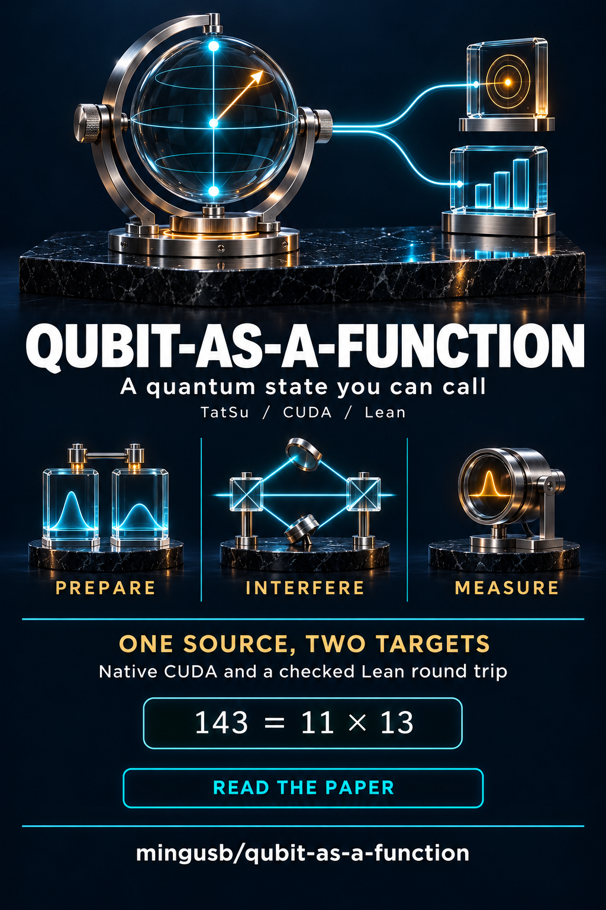

# Qubit-as-a-Function

QAF lets a program call a qubit. Prepare a control in a superposition, use it to select one of two unitary operations, then probe it. The target can become entangled with the control. A register's amplitudes or density operator determine the probabilities throughout.

**Brian Mingus · Cognatory, LLC · November 8, 2026**

[Read the paper](paper.pdf) · [See the QAF factoring source](examples/prefix/factoring.qaf) · [Inspect the CUDA and Lean build](builds/shor143) · [Browse the proofs](lean)

## Start here

Use Python 3.12 on Linux or WSL. Run commands from the directory containing this file.

~~~sh
python -m venv .venv
source .venv/bin/activate
python -m pip install -r requirements.txt
python run_qaf.py examples/prefix/callable.qaf --backend cpu
python run_qaf.py examples/prefix/hilbert.qaf
~~~

The callable Bell program returns probabilities `[0.5, 0, 0, 0.5]` and local X-probe probability `0.5`, to rounding. The Hilbert program gives exact rational results `1/43046721`, `24/25` and `-64/225`. The nonlinear example evaluates an infinite-width sine-network tangent kernel.

## GPU and PyTorch

The tested machine used an NVIDIA RTX A5000 Laptop GPU and CUDA 13. CuPy requires appropriate driver, compiler runtime, headers and BLAS libraries. Its toolkit extra can supply the user-space components.

~~~sh
python -m pip install 'cupy-cuda13x[ctk]==14.2.0'
python run_qaf.py examples/prefix/callable.qaf --backend cuda
python run_qaf.py examples/prefix/teleport.qaf
python run_qaf.py examples/prefix/hilbert.qaf --emit-register 8 > projected.qaf
python run_qaf.py projected.qaf --backend cuda
~~~

Local auto selection uses CUDA when visible, then CPU. Exact series use rational arithmetic and generate normalized finite circuits on request. Dense pure state storage grows exponentially. A density matrix or multiple classical sectors require substantially more memory.

Install CUDA-enabled PyTorch using its official installation instructions. The evidence records PyTorch 2.14.0+cu132. The generated Python file is an ordinary PyTorch module. The PyTorch amplitude backend covers pure circuits. Native CUDA and NumPy also implement mixed-state channels and instruments.

~~~sh
python qaf_torch.py examples/prefix/wave_net.qaf --emit wave_model.py
python run_qaf.py examples/prefix/callable.qaf --backend torch
python neural_demo.py
~~~

The neural demonstration tests a variational wavefunction against the discrete Dirichlet Hamiltonian and executes the unchanged seventeen-wire factoring file on network-defined inputs. Two-amplitude network outputs are normalized and identified up to global phase. Distinct parameter settings can denote the same qubit.

## Factoring and the joint build

`examples/prefix/factoring.qaf` contains the complete ordinary and short-log quantum routines. The factoring driver supplies public inputs, samples the resulting probabilities and calls Martin Ekerå's Quaspy classical post-processing. The short-log example assumes distinct, equal-bit-length odd prime factors and a coprime base with sufficient order. Failed attempts are recorded.

~~~sh
python -m pip install quaspy==0.9.4
python factoring.py 21 --base 2 --method shor --verify
python factoring.py 143 --base 2 --method shortlog --verify
python factoring.py 143 --emit factor143.qaf
~~~

Install Lean 4.24.0 and put `lean` on PATH or set `LEAN` to the executable. One build command creates a new output directory.

~~~sh
python build_qaf.py examples/prefix/factoring.qaf fresh-build
python lean_bridge.py from-lean fresh-build/Program.lean recovered.qaf
cmp examples/prefix/factoring.qaf recovered.qaf
~~~

`builds/shor143/` is the completed artifact. Its CUDA source, generated expressions, gate tables and plan execute independently of the TatSu parser. The build replays the GPU state and compares every element. It then evaluates the embedded Lean program and checks the recovered UTF-8 bytes. The manifest gives the verification results and hashes. In Python use `from build_qaf import replay` and `replay(Path("builds/shor143"))` to execute the saved device plan.

## Language and style

The published form starts with `syntax prefix`. A form has a name followed by operands. Indentation groups nested forms. Balanced S-expressions are supported too. `(cis (* pi b))` and the next expression describe the same function.

~~~text
cis
    * pi b
~~~

Use four spaces, snake_case names for routines, parameters, variables and user-defined operations, and capitalized class names. Mathematical gates keep their conventional names. Omit optional punctuation in prefix listings. Conventional syntax also accepts braces or consistent indentation, optional block colons and optional terminal semicolons. Alternative consistent indentation widths or tabs are accepted. The Lean bridge preserves the original source spelling.

| Prefix forms | Purpose |
|---|---|
| qubits, bits, state | Allocate registers and define a normalized amplitude function |
| fn, invoke, show response | Bind or call a wire and inspect an admissible effect |
| gate, channel, super, apply | Declare matrix kernels, Kraus families or wrappers and apply them |
| measure, if_bit, repeat | Measure, use a classical record or repeat a block |
| def, class, proc | Define numeric/record routines, classes and circuit generators |
| let, set, if, else, while, return | Local variables, branches, loops and results |
| args, type, returns, field, method, pipe | Type parameters and results, access a field or compose method calls |
| place, do, mulmod | Emit an operation, call a generator or reversibly multiply residues |
| hilbert, term, basis, product, diagonal | Describe a normalized series over two countably infinite modes |
| show tail, show fidelity, show svm, show network | Inspect a truncation, fidelity, hard-margin or nonlinear soft-margin score |
| network, input, linear, tanh, relu, sigmoid, sine | Declare a feedforward neural model |
| qubo, ising, linear, pair, offset | Define a binary or spin energy polynomial |

Wire zero is the leftmost bit. Effect coefficients correspond to I, X, Y and Z. Amplitude inspection requires a unitary-only program. Recursive routines and loops have resource guards. A function-qubit is a physical wire. A classical procedure that describes a circuit runs during staging.

## Platform adapters

~~~sh
python -m pip install -r requirements-providers.txt
python run_qaf.py examples/prefix/bell_state.qaf --backend cirq-local --shots 100
python run_qaf.py examples/prefix/bell_state.qaf --backend braket-local --shots 100
python run_qaf.py examples/prefix/onehot.qaf --backend ocean-local
python run_qaf.py examples/prefix/bell_state.qaf --export quil
~~~

For configured hardware sampling set `QAF_QPU` to braket, azure, google or dwave and request shots. Set `QAF_TARGET` to the AWS device ARN, Azure target name or Google processor ID as applicable. Google uses `GOOGLE_CLOUD_PROJECT`. Azure uses `AZURE_QUANTUM_WORKSPACE_RESOURCE_ID` and `AZURE_QUANTUM_WORKSPACE_LOCATION`. Ocean uses Leap credentials and optionally `QAF_DWAVE_SOLVER`. A remote sampling request may create a billable job. Unsupported program lowering fails before submission.

Quil has an independent emitted-text reader and readout certificate. Google uses metadata-validated phased single-qubit gates with CZ or square-root iSWAP. Ocean's reconstructed coefficients must agree with the input energy polynomial. Factoring's arbitrary-angle Fourier and modular instructions are local-simulation operations outside the exact hardware export profile. `evidence/azure-bell-submitted.qaf` preserves the exact original source of the one 100-shot hosted Rigetti simulator job. Braket, Cirq and Ocean were exercised using local simulators. IonQ was checked offline.

## Checks and typesetting

~~~sh
python -m pip install -r requirements-analysis.txt
python verify.py --gpu --providers --record evidence/checks.json
python verify_surface.py
PYTHONPATH=. python examples/check_callable.py
cd lean
export LEAN_PATH=.
lean -o QAF.olean QAF.lean
for source in Algebra.lean Physical.lean Recursive.lean Networks.lean Quil.lean; do lean "$source" || exit 1; done
cd ..
~~~

Lean checks both translation identities, coordinates and their restrictions/quotients, recursive splitting, the algebra, typed preservation under physical primitives, and equivalence of network parameter classes with their reachable outputs. The Python interpreter, numerical CUDA compiler, and proprietary backends are outside the formal proof.

The paper uses TeX Live 2025, minted 3.7.0, latexminted 0.6.0 and Pygments 2.21.0. Install the supplied lexer into the same Python environment as latexminted.

~~~sh
python -m pip install latexminted==0.6.0 Pygments==2.21.0 ./highlighting
python make_figure.py
pdflatex -shell-escape -halt-on-error paper.tex
pdflatex -shell-escape -halt-on-error paper.tex
~~~

The archive includes the populated minted cache and editable linked bibliography. The three supplied reviews are identified in the opening section. The Quantum article class is distributed under the LaTeX Project Public License identified in its header.
